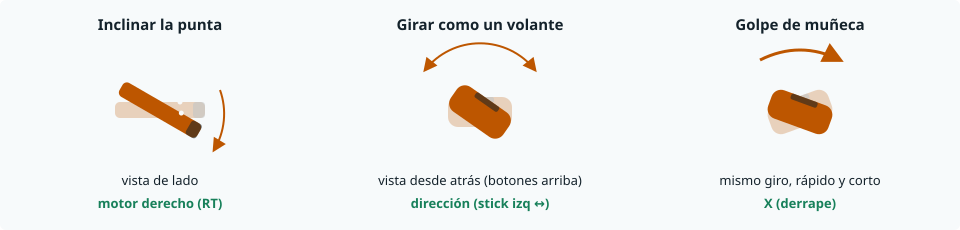
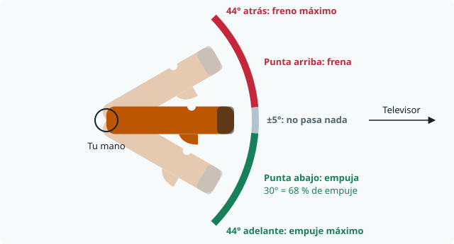
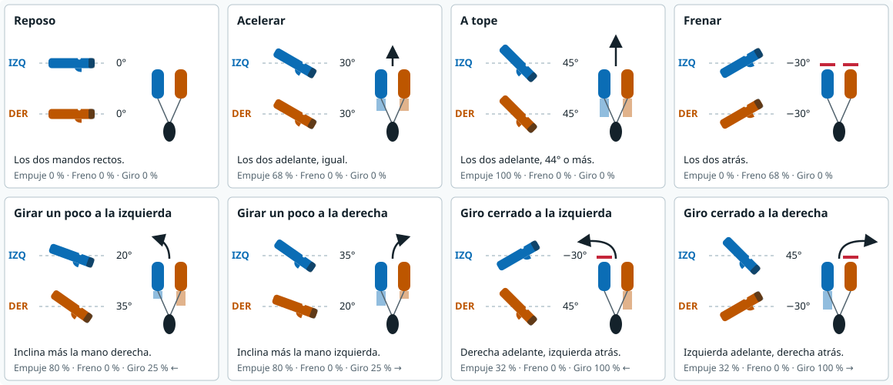
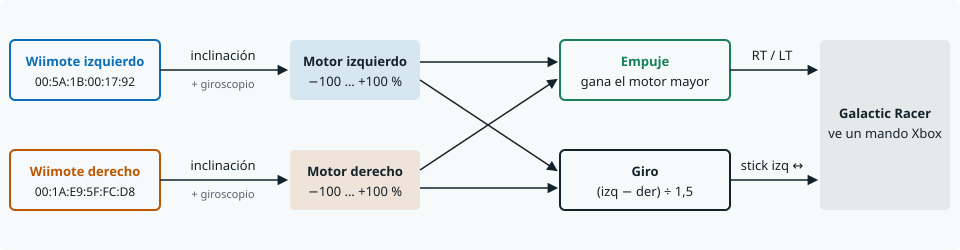
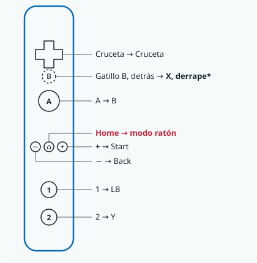
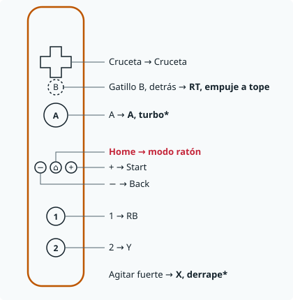

# iwiRacer

Usa mandos de Wii en Linux como un mando Xbox 360 virtual. Pensado para **STAR WARS: Galactic Racer** con Proton, pero sirve para cualquier juego que acepte un mando Xbox.

No toca los archivos del juego. El juego solo ve un mando Xbox normal.

## Qué hace

- Wiimote y Nunchuk: botones, stick y vibración.
- Movimiento: inclinar o agitar los mandos, y puntero IR.
- Modo podracer: cada mando es una palanca de motor.
- Dos Wiimotes sin Nunchuk, como un solo mando.
- MotionPlus (también los no oficiales): giroscopio para ángulos más estables y golpes de muñeca.
- Modo ratón: Home cambia entre mando y ratón. El puntero se mueve con el Wiimote o con el stick del Nunchuk.
- Interfaz para configurarlo todo, con vista del mando en directo.

## Estado

| Función | Probado con |
|---|---|
| Botones y vibración | Mando real |
| Movimiento, IR, ratón | Datos simulados |
| Dos Wiimotes como palancas | Dos mandos reales en Galactic Racer. Los ajustes aún están en prueba |
| MotionPlus | Dos MotionPlus no oficiales reales: sentido de los ejes medido. Falta probar en el juego |
| Wiimote + Nunchuk en Galactic Racer | Aún sin probar |

Solo se ha probado en Arch Linux.

## Instalar

1. Instala lo necesario. Hace falta Python 3.11 o superior.

   ```sh
   # Arch
   sudo pacman -S --needed git python base-devel bluez bluez-utils pyside6
   # Debian / Ubuntu
   sudo apt install git python3-venv python3-dev build-essential bluez
   # Fedora
   sudo dnf install git python3-devel gcc bluez
   ```

2. Descarga e instala. El instalador pide `sudo` para los permisos de los dispositivos.

   ```sh
   git clone https://github.com/Kalaminator/iwiRacer.git
   cd iwiRacer
   ./install.sh
   ```

3. Cierra la sesión y vuelve a entrar si el mando virtual no aparece.

## Conectar un mando de Wii

Solo hace falta la primera vez. Pulsa el botón rojo **SYNC**, bajo la tapa de las pilas, y ejecuta:

```sh
bluetoothctl --agent NoInputNoOutput
scan on
```

Sin `--agent NoInputNoOutput`, el emparejamiento puede pedir un PIN o fallar con `AuthenticationCanceled`.

Cuando aparezca `Nintendo RVL-CNT-01` (o `RVL-CNT-01-TR`), copia su dirección y escribe:

```sh
pair DIRECCION
trust DIRECCION
connect DIRECCION
scan off
exit
```

Las siguientes veces, pulsa **1 + 2** en el mando y conéctalo:

```sh
bluetoothctl connect DIRECCION
```

## Configurar

Abre **iwiRacer** en el menú de aplicaciones. Pulsa **Guardar y aplicar** después de cada cambio.

- **Modo:** la lista de arriba aplica el cambio al momento. Solo activa o apaga estas opciones. El resto de tus ajustes no cambia.
  - **Galactic Racer: Wiimote + Nunchuk**
  - **Galactic Racer: Wiimote + Nunchuk + MotionPlus:** consulta [Pilotar con MotionPlus](#pilotar-con-motionplus).
  - **Galactic Racer: dos Wiimotes como palancas**
  - **Ratón: puntero**
  - **Dolphin: Wiimote libre:** el programa suelta los Wiimotes. Cierra la ventana antes de abrir Dolphin. Sin probar con Dolphin.
- **Botones, Stick:** qué hace cada control.
- **Movimiento:** convierte el movimiento en stick o botones. Elige el mando (Wiimote, Nunchuk, Barra IR o MotionPlus) y el movimiento. La marca ✓ indica los activados.
- **Juego:** curva de dirección y botón para recentrar (por defecto, **2**), filtro 1 € para la inclinación, ignorar la inclinación al agitar y una sola pulsación por sacudida. Cada mejora se puede apagar.
- **Vibración:** envía la vibración del juego al Wiimote.
- **Dos Wiimotes:** elige el modo **Galactic Racer: dos Wiimotes como palancas**, conecta los dos, inclina uno y mira las barras. Si se mueve la barra equivocada, marca **Intercambiar izquierda y derecha**. Consulta [Pilotar con dos Wiimotes](#pilotar-con-dos-wiimotes).
- **Ratón:** elige **Wiimote** o **Stick del Nunchuk**. El Wiimote usa el mejor sensor activo:
  1. **MotionPlus:** giras el mando y el puntero lo sigue. Si la barra está activa, corrige la deriva.
  2. **Barra de sensores:** apuntas a la barra.
  3. **Inclinación:** sin los otros dos, inclinas el mando. Cuanto más lo inclinas, más rápido va el puntero. Solo mide inclinación, no giro a izquierda o derecha. La posición al entrar en modo ratón es el centro.

  El estabilizador usa el filtro 1 €, reduce el temblor y para el puntero un momento al hacer clic.
- **MotionPlus:** deja el Wiimote quieto 1 segundo al conectarlo. Así aprende su punto cero.

## Pilotar con MotionPlus

Elige el modo **Galactic Racer: Wiimote + Nunchuk + MotionPlus**. El Nunchuk sigue igual.



Al conectar, deja el Wiimote quieto 1 segundo.

### MotionPlus no oficiales

El driver de Linux (`hid-wiimote`) no reconoce muchos MotionPlus no oficiales: los detecta y los quita un segundo después. En el registro del kernel sale `cannot detect extension; 00:00:a4:20:05:05`.

iwiRacer lee esos MotionPlus directamente (`rawmplus.py`, por `/dev/hidraw*`). El instalador da el permiso. No tienes que hacer nada más. Los botones, el acelerómetro, el IR y la vibración siguen por el driver normal.

Para comprobar el sentido de los ejes de tus MotionPlus (apaga antes el servicio):

```sh
systemctl --user stop wiimote2xbox
.venv/bin/python test_motionplus.py
systemctl --user start wiimote2xbox
```

Mueve los mandos cuando lo pida. Copia los valores `invert_*` que salen en la pestaña **MotionPlus**.

## Pilotar con dos Wiimotes

Cada mando es la palanca de un motor. La mano izquierda mueve el motor izquierdo. La mano derecha mueve el motor derecho.

### Cómo se coge



Coge cada mando en horizontal, con la punta hacia el televisor y los botones hacia arriba. Solo cuenta cuánto inclinas la punta. La distancia al televisor, la altura de la mano y el giro de la muñeca no cuentan.

### Las ocho maniobras



Regla fácil: **la nave gira hacia el lado del mando que va más atrás.** Los ángulos se miden desde tu posición recta.

### Qué hace el programa



Si el Wiimote tiene MotionPlus, el giroscopio ayuda a medir la inclinación: la palanca tiembla menos y responde antes. Los ajustes no cambian. Opción **Usar el MotionPlus si está** en la pestaña **Dos Wiimotes** (`use_motionplus`). Un mando sin MotionPlus usa solo el acelerómetro.

Cada motor llega a las dos salidas. Si un motor va adelante y el otro atrás, el que va atrás quita empuje: 100 % adelante y 68 % atrás dan 32 % de empuje.

### Botones

| Mano izquierda | Mano derecha |
|---|---|
|  |  |

**No pulses Home en una carrera.** Home cambia al modo ratón y pierdes el control de la nave. Púlsalo otra vez para volver.

\* Turbo y derrape vienen de las notas del Binder de HOTAS. Falta comprobarlos en el juego.

### Antes de jugar

1. Pulsa **1 + 2** en cada mando y conéctalo con `bluetoothctl connect DIRECCION`.
2. En la ventana de configuración, elige **Galactic Racer: dos Wiimotes como palancas**.
3. Si la nave gira al revés, cambia los mandos de mano o marca **Intercambiar izquierda y derecha**.

### Ajustes

Están en la pestaña **Dos Wiimotes** (sección `[two_wiimotes]` de `config.toml`).

| Opción | Valor actual | Qué hace |
|---|---|---|
| Recorrido del giro (`steer_range`) | 1,5 | Más alto: giro más fino. Más bajo: giro más rápido. |
| Zona muerta (`deadzone`) | 8 | Más alto: el mando tarda más en responder y tiembla menos. |
| Recorrido máximo (`max`) | 70 | Inclinación para el empuje máximo. 70 son 44°. |
| Centro izquierda (`center_left`) | −1 | Lo que lee el mando izquierdo cuando está recto. |
| Centro derecha (`center_right`) | 12 | Lo que lee el mando derecho cuando está recto. |
| Usar el MotionPlus si está (`use_motionplus`) | sí | El giroscopio ayuda a medir la inclinación. |

Los centros dependen de cada mando. Mide los tuyos en la pestaña **Dos Wiimotes**.

Los porcentajes salen de las funciones del programa (`pod_drive` y `pod_turn`) con estos ajustes. Son calculados. El juego puede responder de otra forma.

## En Steam

En el juego: **Propiedades → Mando → Desactivar Steam Input**. Si el juego no ve el mando, prueba con Steam Input activado.

## Pruebas

```sh
.venv/bin/python test_axis.py
.venv/bin/python test_pointer.py
.venv/bin/python test_gui.py

# Con mandos simulados. Apaga antes el servicio y los mandos reales.
systemctl --user stop wiimote2xbox
.venv/bin/python test_two_wiimotes.py
systemctl --user start wiimote2xbox
```

## Licencia

GPL-3.0. Consulta [LICENSE](LICENSE).

La mezcla de palancas del modo podracer está adaptada de Galactic Racer HOSAS/HOTAS Binder, © 2026 JaffaQuake, GPLv3. La lógica de zona muerta se inspira en [x360ce](https://github.com/x360ce/x360ce). El puntero usa el [filtro 1 €](https://cristal.univ-lille.fr/~casiez/1euro) (Casiez, Roussel y Vogel, CHI 2012) y la técnica «tightening» de GyroWiki.

Proyecto no oficial. Sin relación con Nintendo, Microsoft, Lucasfilm ni los creadores del juego.
